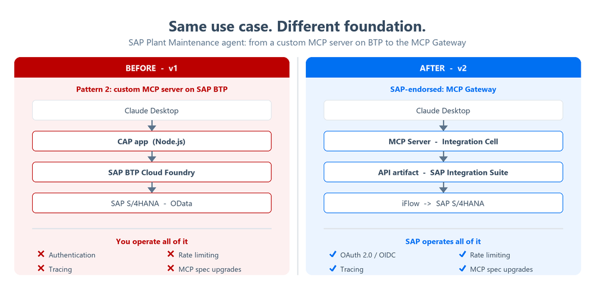
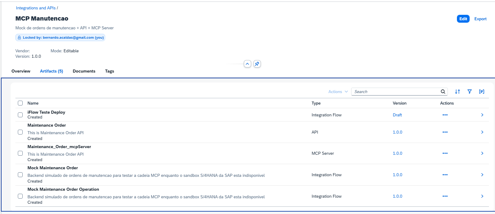
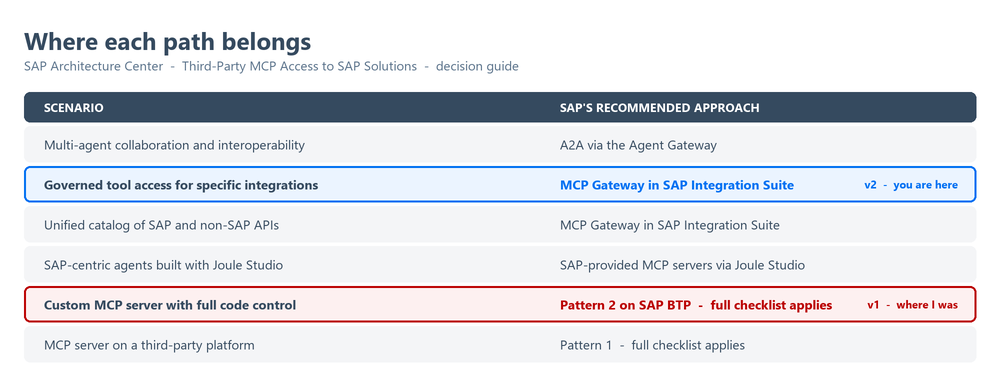
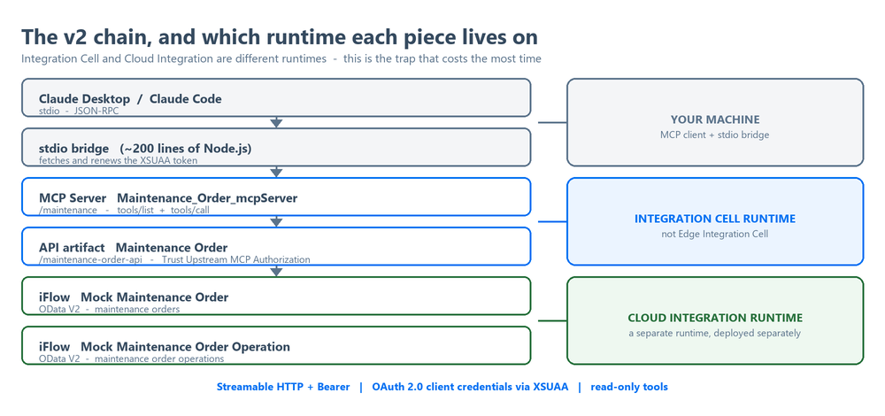
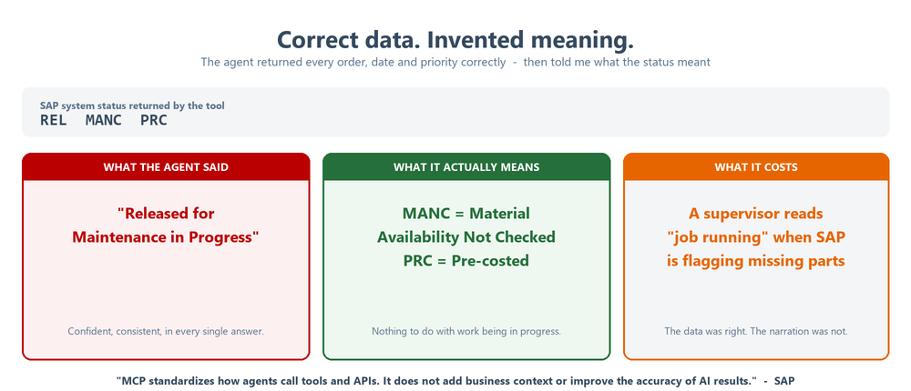

# MCP Server for SAP Plant Maintenance on SAP Integration Suite

I rebuilt my SAP Plant Maintenance AI agent on the **MCP Gateway in SAP Integration Suite**, ran it
end to end with Claude Desktop, and **published the write-up on SAP Community**.

**Read the post:** [MCP Server for SAP Plant Maintenance on SAP Integration Suite: From CAP to the Governed Path](https://community.sap.com/t5/technology-blog-posts-by-members/mcp-server-for-sap-plant-maintenance-on-sap-integration-suite-from-cap-to/ba-p/14485732)

## Demo

Claude Desktop calling the MCP Server on SAP Integration Suite. No transaction code, no filter
screen, no SAP GUI open anywhere.

## What changed from v1

| | v1 | v2 (this project) |
|---|---|---|
| MCP server | CAP app on Node.js, Cloud Foundry | MCP Server artifact on Integration Cell |
| Who operates it | me: auth, rate limit, tracing, spec upgrades | SAP Integration Suite |
| Reference pattern | Pattern 2, custom MCP server | MCP Gateway |
| Code | [mcp-maintenance-cap](https://github.com/bernardcaldas/mcp-maintenance-cap) | the bridge in this repo |

The package as built in my SAP Integration Suite trial tenant: the MCP Server, the API artifact and
the two iFlows that simulate the backend.

The decision table is redrawn from the SAP Architecture Center page
[Third-Party MCP Access to SAP Solutions](https://architecture.learning.sap.com/docs/ref-arch/137800).

## Architecture

Claude Desktop reaches a governed MCP Server through a small stdio bridge. The MCP Server and the
API artifact run on **Integration Cell**; the iFlows behind them run on **Cloud Integration**.
Authentication is OAuth 2.0 client credentials via XSUAA, and the three tools are read-only.

The artifacts themselves live in my SAP BTP trial tenant and are deliberately **not** published here,
since the exported API artifact embeds credentials. This repo holds the client side: [the bridge](bridge/).

## What I learned

- **The agent does not invent data, it invents meaning.** Every order, date and sum came back
  correct, but the status `REL MANC PRC` was narrated as "released for maintenance in progress".
  Status codes reach the model as opaque strings, so the glossary belongs in the tool descriptions,
  on the server.
- **The dangerous error is the one that does not error.** A backend that silently ignores a filter
  it does not understand returns plausible, wrong answers. Reject instead of ignoring.
- **Endpoint-shaped tools push business rules into the prompt.** "Open", "overdue" and "blocked"
  have no field; they belong in calculated fields or intent-shaped tools.
- **Test layer by layer.** Five hops separate the client from the data; testing each one in
  isolation turns a generic 401 into a specific cause.
- **Integration Cell is not Cloud Integration.** Different runtimes, deployed separately.

## Data source and disclaimer

This project is a **demonstration**. The data model follows the `API_MAINTENANCEORDER` OData API from
the free [SAP Business Accelerator Hub](https://api.sap.com/) sandbox, which is what the API artifact
was designed against. While building it, that public sandbox started returning 401, so the records
you see in the demo come from two iFlows in my own trial tenant that reproduce the same contract.
No customer data and no productive SAP system is involved. This is an independent personal project,
not an SAP product, and it is not affiliated with or endorsed by SAP.

A validated proof of concept, read-only, not production. The integration chain is what you would
deploy against a real backend; the maintenance order records are simulated by two iFlows, because
SAP's public S/4HANA sandbox was returning 401 and `API_MAINTENANCEORDER` was deprecated in July 2026.

Next steps: tools shaped around business outcomes instead of endpoints, status glossaries in the
tool descriptions, and token exchange so a named user identity reaches SAP.

## Links

- [SAP Community post (v2)](https://community.sap.com/t5/technology-blog-posts-by-members/mcp-server-for-sap-plant-maintenance-on-sap-integration-suite-from-cap-to/ba-p/14485732)
- [Demo video](https://www.youtube.com/watch?v=h9AUzt85rGk)
- [v1 post: MCP, CAP and Claude Desktop](https://community.sap.com/t5/technology-blog-posts-by-members/building-an-ai-agent-for-sap-maintenance-using-mcp-cap-and-claude-desktop/ba-p/14383338) and [v1 code](https://github.com/bernardcaldas/mcp-maintenance-cap)
- [MCP Gateway in SAP Integration Suite](https://community.sap.com/t5/technology-blog-posts-by-sap/mcp-gateway-in-sap-integration-suite-your-apis-ready-for-the-age-of-agents/ba-p/14438250)
